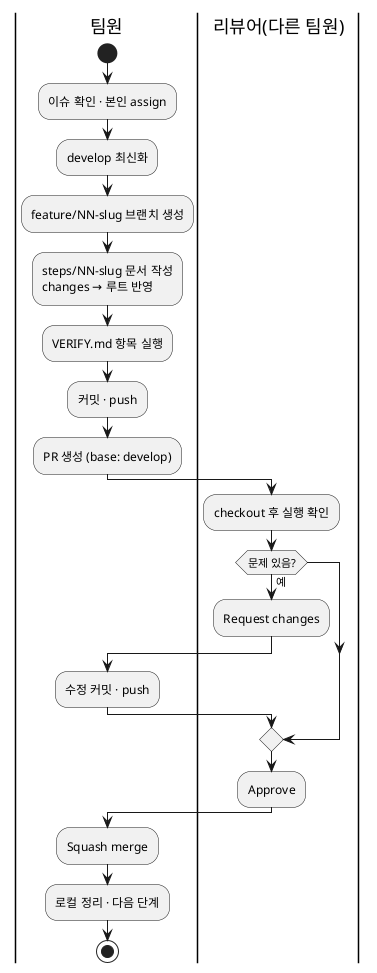

# TEAM_GUIDE.md — 팀원 협업 가이드

> 저장소: https://github.com/metahomo/miniproject4_containerized-ml-env-team1
> 대상: 팀원 B(Linux·자동화), C(Docker·Compose), D(ML·API)
> 방식: 같은 저장소의 협업자(Collaborator)로 참여한다. 포크하지 않고 이 저장소 안에서 브랜치를 만들어 PR을 올린다.
> 원칙: **이슈 하나 = 단계 폴더 하나 = 브랜치 하나 = PR 하나**

---

## 0. 한눈에 보는 흐름



---

## 1. 참여 준비 (최초 1회)

### 1-1. 초대 수락
- 메일 또는 GitHub 알림(🔔)에서 `metahomo invited you to collaborate` → **Accept invitation**
- 또는 https://github.com/metahomo/miniproject4_containerized-ml-env-team1/invitations 접속 후 수락
- 수락해야 이슈 담당자 지정과 push가 가능하다.

### 1-2. 도구 설치 확인 (WSL2 터미널)
```bash
git --version
gh --version || (sudo apt update && sudo apt install -y gh)
docker --version
```

### 1-3. GitHub 로그인
```bash
gh auth login
```
- GitHub.com → HTTPS → Login with a web browser 순으로 선택한다.
- 이후 `git push` 시 비밀번호를 따로 묻지 않는다(gh가 자격 증명을 관리).

### 1-4. Git 설정
```bash
git config --global user.name  "<nlpwhiz>"
git config --global user.email "<nlpwhiz@gmail.com>"
git config --global core.autocrlf input
git config --global pull.rebase true
git config --global init.defaultBranch main
```
| 설정 | 의미 |
|---|---|
| `core.autocrlf input` | Windows 줄바꿈(CRLF)이 저장소에 들어가지 않게 LF로 저장 |
| `pull.rebase true` | `git pull` 시 불필요한 merge 커밋을 만들지 않음 |

### 1-5. 저장소 클론
```bas


21ca5-6988ea43b9-9a49398de7-8ff2715d09-44a216c32f-46c87dd04b-9f8f1b2223-94d1c36ce6-71e62c244f-69a5a1e242-f6c740e4c0-b887d799e4-cae9f0e437-90a3fb9923-a6b007f265-ade0962fc7-8dcb9


gh api -X PUT repos/$REPO/collaborators/Rutural
gh api -X PUT repos/$REPO/collaborators/Hyungnss
gh api -X PUT repos/$REPO/collaborators/rulalrala


git switch -c develop
git push -u origin develop
gh repo edit $REPO --default-branch develop


gh repo edit $REPO \
  --enable-squash-merge \
  --enable-merge-commit \
  --enable-rebase-merge=false \
  --delete-branch-on-merge
  
  
gh repo view $REPO --json defaultBranchRef,squashMergeAllowed,mergeCommitAllowed,rebaseMergeAllowed,deleteBranchOnMerge
git branch -a


gh api repos/$REPO/rulesets --jq '.[] | .name + " " + .enforcement'

h
cd ~
gh repo clone metahomo/miniproject4_containerized-ml-env-team1
cd miniproject4_containerized-ml-env-team1
git branch -a
```
- **WSL 홈(`~`) 아래에 클론한다.** `/mnt/c/...`(Windows 드라이브)에 두면 Docker 볼륨 권한·속도 문제가 생긴다.
- `remotes/origin/develop`이 보이면 정상이다.

---

## 2. 작업 한 사이클

예시: C가 `06-compose-db`를 진행하는 경우. 본인 단계 번호로 바꿔서 따라 한다.

### 2-1. 이슈 확인과 assign
```bash
gh issue list --assignee @me
gh issue view 6
```
- 웹: Issues 탭 → `[06] ...` → 오른쪽 Assignees에 본인이 있는지 확인한다.
- Projects 보드에서 카드를 **In Progress**로 옮긴다.
- 선행 단계(예: 06은 04·05)가 머지되었는지 확인한다. 안 되었으면 담당자와 조율한다.

### 2-2. develop 최신화와 브랜치 생성
```bash
git switch develop
git pull
git switch -c feature/06-compose-db
```
| 명령 | 의미 |
|---|---|
| `git switch develop` | 통합 브랜치로 이동 |
| `git pull` | 다른 팀원이 머지한 최신 내용 받기 |
| `git switch -c feature/06-compose-db` | 새 작업 브랜치 생성과 이동 |

- 브랜치명은 단계 폴더명과 같게: `feature/NN-slug`

### 2-3. 작업
1. `docs/PROMPT.md`를 AI 어시스턴트에 넣고 "06 단계 생성"을 요청한다. 이전 단계 `steps/05-*/completed/`도 함께 제공한다.
2. 받은 결과를 `steps/06-compose-db/`에 저장한다(9개 항목).
3. `steps/06-compose-db/changes/`의 파일을 **저장소 루트의 같은 경로**에 반영한다.
```bash
cp -r steps/06-compose-db/changes/. ./
git status
```
4. `VERIFY.md`의 명령을 직접 실행하고, "실제 검증 여부"를 `검증됨` / `실패(사유)`로 고친다.

### 2-4. 커밋
```bash
git add steps/06-compose-db docker-compose.yml .env.example
git status                      # .env 같은 비밀 파일이 없는지 반드시 확인
git commit -F steps/06-compose-db/COMMIT_MESSAGE.txt
```
- `git add .` 대신 파일을 지정하는 습관을 들인다.
- 커밋 메시지 형식:
```text
feat(compose): api·db 서비스 연결과 healthcheck 추가

- db 준비 완료 후 api 기동(depends_on: service_healthy)
- 환경 변수를 .env.example로 분리

Refs: #6
```

### 2-5. push와 PR 생성
```bash
git push -u origin feature/06-compose-db
gh pr create --base develop --title "[06] Compose로 api·db 서비스 연결" \
  --body-file steps/06-compose-db/PR.md \
  --label "type:feat,area:docker" --milestone "Day 2" \
  --reviewer <리뷰어ID>
```
- 웹: push 후 저장소 상단의 **Compare & pull request** → base가 `develop`인지 확인한다.
- PR 본문에 `Closes #6`이 있어야 머지할 때 이슈가 자동으로 닫힌다.
- Projects 카드를 **In Review**로 옮긴다.

### 2-6. 리뷰 반영
```bash
# 같은 브랜치에서 수정 후
git add <수정 파일>
git commit -m "fix(compose): db healthcheck 간격 조정" -m "Refs: #6"
git push
```
- 새 PR을 만들지 않는다. 같은 브랜치에 push하면 기존 PR에 자동으로 추가된다.
- 리뷰 코멘트에 답글을 달고 **Resolve conversation**을 누른다(미해결 대화가 있으면 머지 불가).

### 2-7. 머지
- 승인 1건 이상, 대화 모두 해결 → PR 하단 **Squash and merge**
```bash
gh pr merge --squash --delete-branch
```
- 머지는 **PR 작성자 본인**이 한다(승인 확인 후).

### 2-8. 로컬 정리
```bash
git switch develop
git pull
git branch -d feature/06-compose-db
git fetch --prune
```
- Squash로 머지되면 `-d`가 "not fully merged"라며 거부할 수 있다. PR이 머지된 것을 확인했다면 `-D`로 삭제한다.

---

## 3. 리뷰어 역할

모든 팀원은 최소 1개의 PR을 리뷰한다.

### 3-1. 리뷰 요청 확인
```bash
gh pr list --search "review-requested:@me"
```

### 3-2. 직접 실행해 보기
```bash
gh pr checkout <PR번호>
cat steps/NN-slug/VERIFY.md
# VERIFY.md의 명령을 그대로 실행
git switch develop        # 확인 후 복귀
```

### 3-3. 확인할 것
- [ ] `.env`, 토큰, 비밀번호가 들어 있지 않다
- [ ] 단계 범위 밖의 변경이 섞이지 않았다
- [ ] VERIFY.md의 "검증됨" 항목이 내 환경에서도 재현된다
- [ ] 줄바꿈이 LF다(파일 전체가 바뀐 diff가 없다)
- [ ] 커밋 메시지와 `Closes #N`이 있다

### 3-4. 결과 남기기
```bash
gh pr review <PR번호> --approve --body "VERIFY 1~4 재현 확인"
gh pr review <PR번호> --request-changes --body "db 포트가 .env.example과 다릅니다"
gh pr review <PR번호> --comment --body "질문: ..."
```
- 웹: PR → Files changed → 줄 번호 옆 `+`로 코멘트 → **Review changes** → Approve / Request changes
- 실행 결과나 오류 로그를 코멘트에 붙이면 발표 증빙이 된다.

---

## 4. 충돌과 동기화

### 4-1. 작업 중 develop이 바뀐 경우
PR 화면에 "This branch is out-of-date" 또는 충돌 표시가 나오면:
```bash
git switch feature/06-compose-db
git fetch origin
git rebase origin/develop
```
충돌이 나면:
```bash
git status                     # both modified 파일 확인
# 파일을 열어 <<<<<<< ======= >>>>>>> 구간을 정리
git add <파일>
git rebase --continue
```
마치면:
```bash
git push --force-with-lease
```
| 명령 | 의미 |
|---|---|
| `git rebase origin/develop` | 내 커밋을 최신 develop 위로 옮김 |
| `git rebase --abort` | 꼬였을 때 rebase 시작 전으로 되돌림 |
| `--force-with-lease` | 원격이 내가 마지막으로 본 상태일 때만 덮어씀(안전한 강제 push) |

- 충돌을 어떻게 해결했는지 PR 코멘트로 한 줄 남긴다.

### 4-2. 같은 파일을 여러 명이 고칠 때
- `docker-compose.yml`, `Makefile`, `README.md`는 충돌이 잦다.
- 수정 전에 팀 채팅에 "06에서 compose의 db 서비스 수정 중"처럼 알리고, 머지 순서를 맞춘다.

---

## 5. 팀원별 담당과 일정

| 담당 | 단계 | 브랜치 | 이슈 제목 | 마일스톤 | 선행 |
|---|---|---|---|---|---|
| B | 03-linux-env | feature/03-linux-env | [03] WSL·Python 환경 점검 스크립트 작성 | Day 1 | 02 |
| B | 08-automation-monitoring | feature/08-automation-monitoring | [08] Makefile과 모니터링 스크립트 작성 | Day 3 | 06 |
| C | 06-compose-db | feature/06-compose-db | [06] Compose로 api·db 서비스 연결 | Day 2 | 04, 05 |
| C | 07-volume-backup | feature/07-volume-backup | [07] named volume과 백업·복원 스크립트 구성 | Day 3 | 06 |
| C | 09-security-resources | feature/09-security-resources | [09] non-root·시크릿 분리·리소스 제한 적용 | Day 3 | 06 |
| D | 04-trainer-image | feature/04-trainer-image | [04] 학습 컨테이너 이미지 작성 | Day 2 | 03 |
| D | 05-api-image | feature/05-api-image | [05] FastAPI 추론 서버 이미지 작성 | Day 2 | 04 |
| D | 11-gpu-profile (선택) | feature/11-gpu-profile | [11] GPU 프로필 구성(선택) | Day 3 | 06 |
| 전원 | 12-docs-demo | feature/12-docs-demo | [12] 최종 문서와 데모 시나리오 작성 | Day 4 | 01~10 |

리뷰 배정(기본):
| PR 작성 | 리뷰어 |
|---|---|
| B | C |
| C | D |
| D | B |
| A | 순환 |

일정 기준:
- Day 1(10/30): B는 03 PR까지
- Day 2(10/31): D는 04·05 오전 머지 목표 → C는 06 오후
- Day 3(11/01): 07·08·09 병렬 진행. 공통 파일 충돌에 주의
- Day 4(11/02): 각자 담당 단계의 README·데모 파트 작성, 리허설

---

## 6. 하면 안 되는 것

| 금지 | 이유 | 대신 |
|---|---|---|
| develop/main에 직접 push | 보호 규칙으로 거부됨 | feature 브랜치 → PR |
| `.env` 커밋 | 공개 저장소라 즉시 노출 | `.env.example`만 커밋 |
| 머지된 브랜치를 재사용 | Squash로 이력이 달라져 충돌 | develop에서 새 브랜치 |
| `git push --force` | 다른 사람 커밋을 지울 수 있음 | `--force-with-lease` |
| 한 PR에 여러 단계 | 리뷰·롤백이 어려움 | 단계별 PR |
| 본인 PR을 리뷰 없이 머지 | 규칙상 불가, 협업 증빙 누락 | 리뷰어 지정 |
| `/mnt/c/`에서 작업 | 권한·성능 문제 | `~/` 아래에서 작업 |

---

## 7. 트러블슈팅

| 증상 | 원인 | 해결 |
|---|---|---|
| `Permission to ... denied` | 초대 미수락 | 1-1 초대 수락 |
| `push declined due to repository rule violations` | develop/main 직접 push | `git switch -c feature/NN-slug` 후 push |
| `rejected (non-fast-forward)` | 원격 브랜치가 앞서 있음 | `git pull --rebase` 후 push |
| `Updates were rejected` (rebase 후) | 이력 재작성 | `git push --force-with-lease` |
| rebase 도중 꼬임 | 충돌 해결 실수 | `git rebase --abort` 후 다시 |
| 실수로 develop에서 커밋함 | 브랜치 안 만듦 | `git switch -c feature/NN-slug`(커밋이 따라옴) → `git switch develop` → `git reset --hard origin/develop` |
| `.env`를 커밋함(push 전) | add 실수 | `git rm --cached .env` → `git commit --amend` |
| `.env`를 push함 | 공개 노출 | **A에게 즉시 알리고 비밀값 폐기·재발급** |
| 모든 줄이 바뀐 diff | CRLF 혼입 | `git add --renormalize .` → 커밋 |
| `/bin/bash^M: bad interpreter` | CRLF 스크립트 | `sed -i 's/\r$//' 파일.sh` |
| `.sh` 실행 시 `Permission denied` | 실행 권한 없음 | `chmod +x 파일.sh` → `git add` 후 커밋(권한도 추적됨) |
| Approve 버튼 비활성 | 내 PR | 다른 팀원에게 요청 |
| Merge 버튼 비활성 | 승인 부족 또는 미해결 대화 | 승인 1건, Resolve conversation |
| `gh: command not found` | 미설치 | `sudo apt install -y gh` |
| Docker 볼륨 권한 오류 | `/mnt/c` 경로 | `~/`로 다시 클론 |

막히면 오류 메시지 전체를 복사해 `[BUG]` 이슈로 올리고 A를 멘션한다(`@metahomo`).