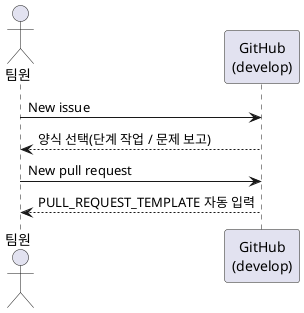

# 파일별 역할과 설계 이유

| 파일 경로 | 역할 | 설계 이유 | 대안과 선택하지 않은 이유 |
|---|---|---|---|
| .github/ISSUE_TEMPLATE/step.yml | 단계 작업용 이슈 양식 | 단계 폴더·배경·할 일·완료 조건을 필수 입력으로 강제해 이슈 형식을 통일 | Markdown 템플릿: 필수 입력 검증이 없음 |
| .github/ISSUE_TEMPLATE/bug.yml | 문제 보고용 양식 | 재현 방법과 로그를 구조화해 원인 파악 시간 단축, type:fix 라벨 자동 부여 | 자유 형식: 정보 누락이 잦음 |
| .github/ISSUE_TEMPLATE/config.yml | 빈 이슈 작성 차단 | 모든 이슈가 양식을 거치게 함 | 허용: 형식 없는 이슈가 섞임 |
| .github/PULL_REQUEST_TEMPLATE.md | PR 기본 양식 | 관련 이슈(Closes #), 검증 결과, 리뷰어 체크리스트를 매번 포함 | 없음: 리뷰 기준이 사람마다 달라짐 |

## 동작 조건
템플릿은 기본 브랜치(develop)에 있어야 적용된다. 머지 전에는 New issue에 양식이 나타나지 않는다.

