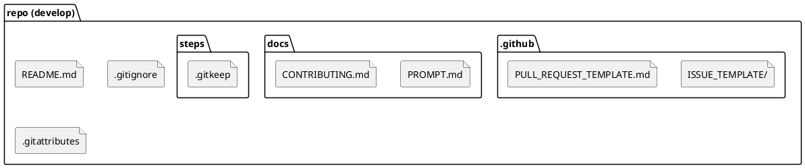

# 파일별 역할과 설계 이유

| 파일 경로 | 역할 | 설계 이유 | 대안과 선택하지 않은 이유 |
|---|---|---|---|
| README.md | 프로젝트 소개, 구성, 팀, 문서 링크 | 저장소 첫 화면에서 프로젝트를 바로 이해하도록 | 프롬프트를 README로 유지: 외부인에게 의미 불명 |
| docs/PROMPT.md | AI 어시스턴트용 프로젝트 프롬프트 | 문서는 docs/에 모아 루트를 단순하게 유지, git mv로 이력 보존 | 삭제 후 새로 작성: 수정 이력 단절 |
| docs/CONTRIBUTING.md | 브랜치·작업 순서·커밋 규칙 | 팀원이 같은 절차를 따르도록 규칙을 문서화 | 구두 공유: 기록이 남지 않음 |
| .gitignore | 추적 제외 대상 | .env 등 비밀값과 모델·데이터 산출물, 캐시가 커밋되지 않도록 | 개별 관리: 공개 저장소에서 노출 위험 |
| .gitattributes | 줄바꿈·바이너리 규칙 | Windows+WSL 혼용 시 CRLF로 인한 전체 diff와 셸 스크립트 오류 방지 | autocrlf만 사용: 팀원 설정에 따라 결과가 달라짐 |
| steps/.gitkeep | steps/ 폴더 유지 | 단계 폴더를 둘 위치를 미리 확보 | 없음: 빈 폴더는 git이 추적하지 않음 |

## 저장소 구조 (02 완료 시점)

